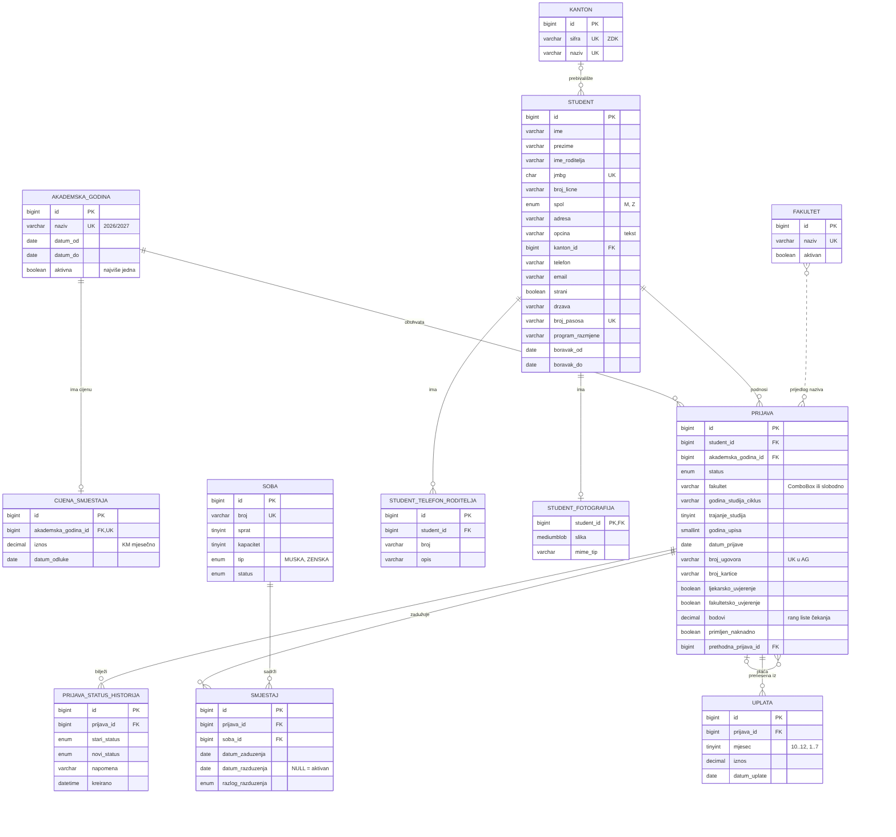
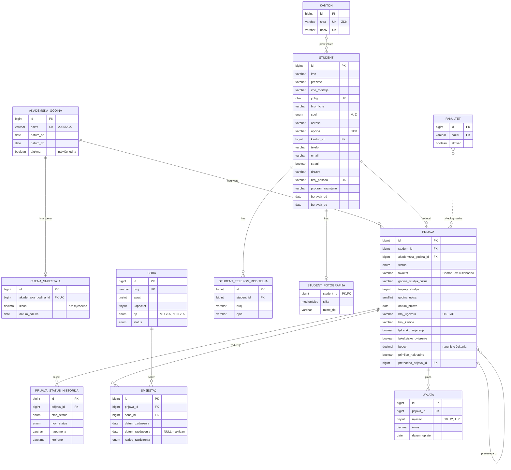
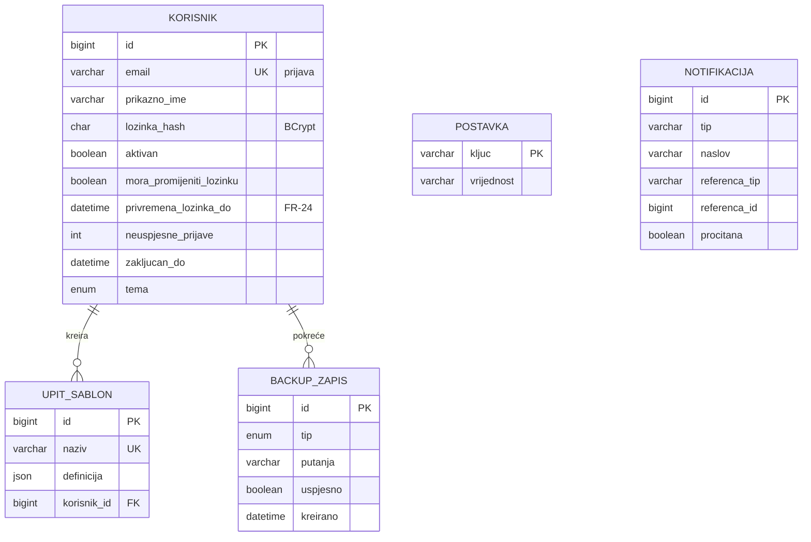

# ER model i SQL šema (D-02)

Fajlovi:

| Fajl | Sadržaj |
| --- | --- |
| [`src/main/resources/db/migration/V1__init.sql`](../../src/main/resources/db/migration/V1__init.sql) | Tabele, PK/FK, indeksi, UNIQUE i CHECK ograničenja |
| [`src/main/resources/db/migration/V2__seed.sql`](../../src/main/resources/db/migration/V2__seed.sql) | Admin nalog, kantoni, fakulteti, AG 2026/2027, cijena 165 KM, sobe, postavke |
| [`src/main/resources/db/migration/R__v_student_pregled.sql`](../../src/main/resources/db/migration/R__v_student_pregled.sql) | Pogledi `v_obracun_prijave` i `v_student_pregled` (repeatable migracija) |
| [`docs/dijagrami/er-dijagram.png`](../dijagrami/er-dijagram.png) | ER dijagram domene (studenti, smještaj, uplate) |
| [`docs/dijagrami/er-dijagram-sistem.png`](../dijagrami/er-dijagram-sistem.png) | ER dijagram sistemskih tabela (korisnici, postavke, notifikacije, šabloni, backup) |

---

## 1. ER dijagram

Sistemske tabele:

Mermaid izvor

`korisnik_id` (ko je unio/izmijenio) postoji i u tabelama `cijena_smjestaja`, `prijava_status_historija`, `smjestaj` i `uplata` (FK na `korisnik`, `ON DELETE SET NULL`). Na dijagramu je izostavljen radi preglednosti.

---

## 2. Tabele

| Tabela | Namjena | FR |
| --- | --- | --- |
| `korisnik` | Nalozi; prijava **e-mailom** (jedinstven) i lozinkom; prikazno ime; BCrypt; blokada nakon neuspjelih prijava; privremena lozinka nakon reseta; tema po korisniku | FR-01..03, FR-20, FR-24 |
| `akademska_godina` | AG s periodom; tačno jedna aktivna | FR-04 |
| `cijena_smjestaja` | Jedna cijena po AG; historija = cijene ranijih AG | FR-04 |
| `kanton` | Šifarnik (10 kantona FBiH + RS + BD) | FR-05 |
| `fakultet` | Prijedlozi za ComboBox (8 fakulteta iz SRS §8.4) | FR-06 |
| `student` | Lični podaci; domaći (JMBG) ili strani (pasoš) | FR-05, FR-11 |
| `student_telefon_roditelja` | Više brojeva roditelja | FR-05 |
| `student_fotografija` | Fotografija u bazi, odvojena od liste studenata | FR-05, NFR-08 |
| `prijava` | Student u jednoj AG: fakultet, ugovor, kartica, uvjerenja, status, bodovi | FR-06, FR-10, FR-13 |
| `prijava_status_historija` | Svaka promjena statusa prijave | FR-10 |
| `soba` | Broj, sprat, kapacitet, tip, status | FR-07, FR-08 |
| `smjestaj` | Zaduženje / premještaj / razduženje sobe | FR-09 |
| `uplata` | Jedan iznos po mjesecu po prijavi | FR-12 |
| `postavka` | Ključ-vrijednost (ustanova, backup putanje, intervali, SMTP i e-mail za reset lozinke) | FR-20, FR-24 |
| `notifikacija` | Zvonce: neplaćen mjesec, stari backup... | FR-18 |
| `upit_sablon` | Sačuvani custom upiti (JSON) | FR-16 |
| `backup_zapis` | Historija backup/restore; datum posljednjeg backupa | FR-19, FR-18 |

Audit log (FR-22, Could) nije u V1; dodaje se novom migracijom ako Z-03 krene.

---

## 3. Ključne odluke modela

1. Svaki student ima jednu prijavu po akademskoj godini. Sobe i uplate su vezane za tu prijavu, pa svaka godina počinje od nule.
2. Lista čekanja nije posebna tabela. To su prijave sa statusom „lista čekanja“, poredane po bodovima pa po datumu prijave.
3. Prijava može biti: prijavljen, lista čekanja, primljen, odbijen ili iseljen. Svaka promjena statusa se bilježi.
4. Fakultet se upisuje kao tekst. Lista fakulteta služi samo kao prijedlog, pa se može upisati i fakultet kojeg nema na listi.
5. Kanton se bira iz liste, a općina se upisuje slobodno.
6. Student mora imati JMBG (domaći) ili broj pasoša (strani). Isti JMBG ne može se unijeti dva puta.
7. Baza ne dozvoljava dvije aktivne akademske godine, niti da je student istovremeno u dvije sobe.
8. Kod premještaja se stara soba zatvori, a nova otvori u istom koraku. Ranije sobe ostaju zapisane.
9. Da li u sobi ima mjesta, provjerava aplikacija pri zaduženju.
10. Za jedan mjesec može postojati samo jedna uplata (nema rata). Za avgust i septembar uplate nema.
11. Student koji ima smještaj ili uplate ne može se obrisati, da se ne izgubi finansijska historija.
12. Fotografije se čuvaju odvojeno, da se liste studenata brže učitavaju.
13. Kod zaboravljene lozinke dobija se privremena lozinka koja kratko važi i mora se promijeniti pri prvoj prijavi.
14. Baza ispravno sortira naša slova (č, ć, dž, đ, š, ž).

---

## 4. Jedinstvenost i indeksi

Baza ne dozvoljava duplikate na ovim mjestima:

Dva studenta s istim JMBG-om ili istim brojem pasoša.
Dvije prijave istog studenta u istoj akademskoj godini.
Isti broj ugovora dva puta u istoj akademskoj godini.
Dvije aktivne akademske godine.
Dvije cijene za istu akademsku godinu.
Dvije sobe s istim brojem.
Student u dvije sobe u isto vrijeme.
Dvije uplate za isti mjesec.

---

## 5. Obračun duga i `v_student_pregled`

Student plaća svaki mjesec u kojem je bio u domu makar jedan dan, od oktobra do jula.
Obaveza je broj tih mjeseci puta cijena za tu godinu.
Dug je obaveza minus ono što je uplaćeno.
Postoje dvije vrste duga: dug do danas (računa i tekući mjesec) i dug za završene mjesece (bez tekućeg). Ovaj drugi koristi dashboard.
Za svakog studenta se vidi i da li je platio prethodni mjesec. To koristi notifikacija.
Ako je student premješten u toku mjeseca, taj mjesec se plaća samo jednom.
Pregled studenata ima jedan red po studentu za tu godinu, s istim kolonama kao Excel sekretarice, uplatama po mjesecima i dugom. Koristi se za „Pregled kao Excel“, izvještaj za ministarstvo i custom upite.

---

## 6. Whitelist kolona za custom upite (FR-16)

Custom upiti (E-05) smiju koristiti **samo** kolone iz tabele ispod, i to isključivo nad pogledom `v_student_pregled`. `QueryBuilder` gradi SQL iz ove liste (imena kolona nikad ne dolaze iz korisničkog unosa), a vrijednosti filtera idu kao parametri `PreparedStatement`-a (NFR-02). Filter `akademska_godina_id` se uvijek dodaje automatski (aktivna AG).

Operatori po tipu:

- **TEKST:** `=`, `≠`, `sadrži`, `počinje sa`, `je prazno`
- **BROJ / NOVAC / DATUM:** `=`, `≠`, `<`, `≤`, `>`, `≥`, `između`, `je prazno`
- **DA/NE:** `=`
- **IZBOR:** `=`, `jedno od`

| Kolona | Labela u UI | Tip | Filter |
| --- | --- | --- | --- |
| `puno_ime` | Prezime (ime roditelja) ime | TEKST | da |
| `prezime` | Prezime | TEKST | da |
| `ime` | Ime | TEKST | da |
| `ime_roditelja` | Ime roditelja | TEKST | da |
| `jmbg` | JMBG | TEKST | da |
| `broj_licne` | Broj lične karte | TEKST | da |
| `spol` | Spol | IZBOR (M, Z) | da |
| `adresa` | Adresa | TEKST | da |
| `opcina` | Općina | TEKST | da |
| `kanton` | Kanton | IZBOR (šifarnik) | da |
| `telefon` | Telefon | TEKST | ne |
| `email` | E-mail | TEKST | ne |
| `telefoni_roditelja` | Telefoni roditelja | TEKST | ne |
| `strani` | Strani student | DA/NE | da |
| `drzava` | Država | TEKST | da |
| `broj_pasosa` | Broj pasoša | TEKST | da |
| `status_prijave` | Status prijave | IZBOR (5 statusa) | da |
| `fakultet` | Fakultet | TEKST | da |
| `godina_studija_ciklus` | Godina studija / ciklus | TEKST | da |
| `trajanje_studija` | Trajanje studija | BROJ | da |
| `godina_upisa` | Godina upisa | BROJ | da |
| `datum_prijave` | Datum prijave | DATUM | da |
| `broj_ugovora` | Broj ugovora | TEKST | da |
| `broj_kartice` | Broj kartice | TEKST | da |
| `ljekarsko_uvjerenje` | Ljekarsko uvjerenje | DA/NE | da |
| `fakultetsko_uvjerenje` | Fakultetsko uvjerenje | DA/NE | da |
| `stanje_smjestaja` | Stanje smještaja | IZBOR (AKTIVAN, RAZDUZEN, BEZ_SMJESTAJA) | da |
| `soba` | Soba | TEKST | da |
| `sprat` | Sprat | BROJ | da |
| `datum_zaduzenja` | Datum zaduženja | DATUM | da |
| `datum_razduzenja` | Datum razduženja | DATUM | da |
| `uplata_10` … `uplata_07` | Oktobar … Juli | NOVAC | da |
| `cijena` | Cijena | NOVAC | ne |
| `mjeseci_obaveze` | Mjeseci obaveze | BROJ | da |
| `obaveza` | Obaveza | NOVAC | da |
| `uplaceno` | Uplaćeno | NOVAC | da |
| `dug` | Dug (do danas) | NOVAC | da |
| `dug_dospjeli` | Dug za završene mjesece | NOVAC | da |
| `neplacen_prethodni_mjesec` | Neplaćen prethodni mjesec | DA/NE | da |

Kolone `prijava_id`, `student_id`, `akademska_godina_id` i `akademska_godina` su tehničke (otvaranje detalja, filter AG) i ne nude se korisniku.

---

## 7. Seed (V2)

- Nalog e-mail `admin@sczenica.ba` / lozinka `admin`, uz obaveznu promjenu lozinke pri prvoj prijavi (e-mail se mijenja na ekranu Korisnici).
- 12 kantona (10 FBiH + Republika Srpska + Brčko distrikt).
- 8 fakulteta iz SRS §8.4.
- AG `2026/2027` (1.10.2026 – 15.7.2027), aktivna, cijena **165 KM**.
- Sobe: mock raspored od 38 soba na 4 nivoa (prizemlje + 3 sprata, sprat 0 = prizemlje), 101 mjesto u upotrebi; prizemlje i 1. sprat muške, 2. i 3. sprat ženske; soba 27 van upotrebe. Brojevi i kapaciteti prate mockup D-06. Stvarne sobe se unose ili ispravljaju na ekranu Sobe (N-02).
- Postavke: naziv i adresa ustanove, backup putanje (prazno), interval backupa 7 dana, upozorenje za backup 7 dana, SMTP (host, port, korisnik, pošiljalac, STARTTLS), e-mail sekretarice za reset i trajanje privremene lozinke (24 h). **SMTP lozinka nije u bazi**, nego u `config.properties` van Gita (NFR-02, D-01).

Demo studenti nisu u V2: mock seed ide uz F3 (SRS §2.5), da ne završi u produkcijskoj bazi.

---

## 8. Provjera

Migracije su provjerene na praznoj MySQL 8.4 bazi (`flyway migrate`: V1, V2, R__ uspješno), uz testove ograničenja (dupli JMBG, druga aktivna AG, drugi aktivni smještaj, uplata za avgust, druga uplata za isti mjesec, duplikat ugovora u AG, brisanje studenta sa smještajem) i obračuna (aktivan student, razdužen, premještaj, dospjeli dug, neplaćen prethodni mjesec), te provjere e-maila naloga.
