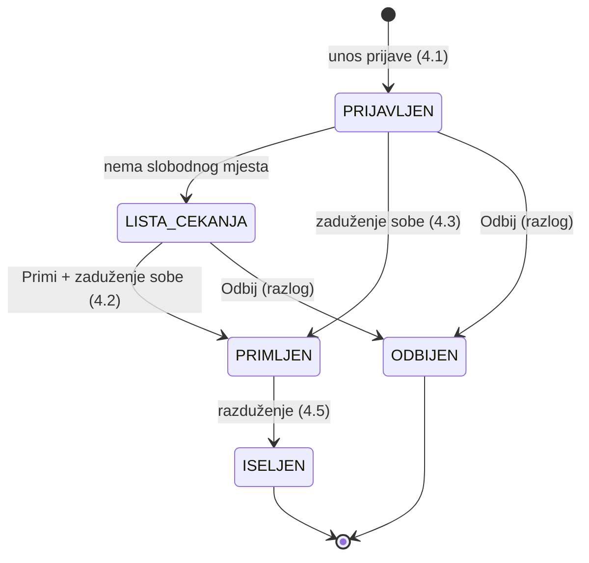
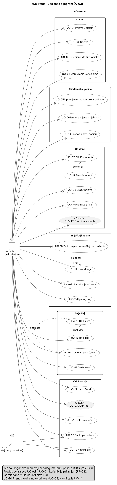

# Poslovni procesi, uloge i use case (A-03)

| | |
| --- | --- |
| **Projekat** | eSekretar |
| **Klijent** | JU Studentski centar Zenica |
| **YouTrack** | A-03 (FR-02, Must) |
| **Autor** | Emin Ahbabović |
| **Verzija** | 1.0 |
| **Datum** | 18.11.2026 |
| **Status** | F1 Analiza: spremno za tim review (A-06) |
| **Veza** | `docs/SRS-v1.0.md` §3 (prava), §4 (procesi), §5 (UC pregled) |

---

## 1. Svrha

Ovaj dokument detaljno razrađuje ono što SRS u §4 i §5 samo nabraja:

- tokove poslovnih procesa (prijem, lista čekanja, zaduženje sobe, uplate, razduženje, prenos),
- aktere i prava pristupa,
- use case dijagram,
- opise glavnih use case-ova (preduslov, osnovni tok, alternativni tokovi, ishod).

UC ID-evi (UC-01 … UC-24) su isti kao u SRS §5. Ako se nešto razlikuje, važi SRS.

---

## 2. Akteri

| Akter | Tip | Opis |
| --- | --- | --- |
| **Korisnik** (sekretarica) | primarni | Prijavljeni korisnik aplikacije. Ima puni pristup svim funkcijama (SRS §2.2, §3). |
| **Sistem** (tajmer / pozadina) | sekundarni | Pokreće automatske radnje bez korisnika: generisanje notifikacija (UC-19) i automatski backup po intervalu (UC-20). |
| Ministarstvo | van sistema | Prima izvezene PDF / `.xlsx` fajlove. Nema pristup aplikaciji, zato nije akter na dijagramu. |

---

## 3. Uloge i prava pristupa

### 3.1 Odluka

Na A-02 sastanku je dogovoreno da aplikaciju koristi samo sekretarica (SRS §11, odluke 12–14). Zato **v1.0 nema podjele ADMIN / SEKRETAR**:

- postoji **jedan tip naloga**, a svaki prijavljeni nalog ima **puni pristup**;
- neprijavljeni korisnik vidi samo ekran za prijavu;
- upravljanje nalozima (UC-04) ostaje, za drugi nalog ili reset lozinke, ali i taj nalog ima puni pristup.

Podjela uloga je van opsega v1.0 (SRS §10). Ako zatreba, uvodi se kroz Change Request.

### 3.2 Matrica prava (v1.0)

| Funkcija | UC | FR | Neprijavljen | Korisnik |
| --- | --- | --- | :---: | :---: |
| Prijava | UC-01 | FR-01 | ✅ | — |
| Odjava, promjena vlastite lozinke | UC-02, UC-03 | FR-01, FR-03 | ❌ | ✅ |
| Upravljanje korisnicima | UC-04 | FR-03 | ❌ | ✅ |
| Akademske godine, cijena smještaja | UC-05, UC-06 | FR-04 | ❌ | ✅ |
| Studenti, prijave, strani studenti | UC-07, UC-08, UC-12 | FR-05, FR-06, FR-11 | ❌ | ✅ |
| Sobe, smještaj, lista čekanja | UC-09, UC-10, UC-11 | FR-07–FR-10 | ❌ | ✅ |
| Uplate i dugovanja | UC-13 | FR-12 | ❌ | ✅ |
| Prenos u novu godinu | UC-14 | FR-13 | ❌ | ✅ |
| Pretraga i filteri | UC-15 | FR-14 | ❌ | ✅ |
| Izvještaji, custom upiti, export PDF / `.xlsx` | UC-16, UC-17 | FR-15, FR-16 | ❌ | ✅ |
| Dashboard, notifikacije | UC-18, UC-19 | FR-17, FR-18 | ❌ | ✅ |
| Backup / restore | UC-20 | FR-19 | ❌ | ✅ |
| Postavke i tema | UC-21 | FR-20 | ❌ | ✅ |
| Uvoz Excela | UC-22 | FR-21 | ❌ | ✅ |
| Audit log, PDF kartica (Could) | UC-23, UC-24 | FR-22, FR-23 | ❌ | ✅ |

### 3.3 Ako se uvede podjela uloga (prijedlog za eventualni CR)

Ovo **nije dio v1.0**. Služi samo kao gotov prijedlog ako klijent kasnije zatraži dvije uloge.

| Funkcija | SEKRETAR | ADMIN |
| --- | :---: | :---: |
| Studenti, prijave, sobe, smještaj, lista čekanja, uplate, prenos | ✅ | ✅ |
| Izvještaji, custom upiti, dashboard, pretraga | ✅ | ✅ |
| Akademske godine | ✅ | ✅ |
| Cijena smještaja | samo pregled | ✅ |
| Vlastita lozinka, tema | ✅ | ✅ |
| Upravljanje korisnicima | ❌ | ✅ |
| Uvoz Excela | ❌ | ✅ |
| Backup / restore, postavke ustanove | ❌ | ✅ |
| Audit log (Could) | ❌ | ✅ |

---

## 4. Poslovni procesi

### 4.0 Životni ciklus prijave (pregled)

Statusi prijave povezuju sve procese ispod. Ovo je samo pregled; detaljni dijagram stanja radi se u F2 (D-03).

### 4.1 Prijem studenta

| | |
| --- | --- |
| **Okidač** | Student preda prijavu na konkurs za smještaj. |
| **Ulaz** | Lični podaci, podaci o studiju, datum prijave, uvjerenja. |
| **UC / FR** | UC-07, UC-08, UC-12 · FR-05, FR-06, FR-11 |

1. Korisnik pretraži da li student već postoji (UC-15), po imenu, JMBG-u ili pasošu.
2. Ako ne postoji, unosi novog studenta (UC-07); za stranog studenta i podatke o pasošu i boravku (UC-12).
3. Za **aktivnu akademsku godinu** unosi prijavu (UC-08): fakultet, godina/ciklus, trajanje studija, godina upisa, datum prijave (konkurs), broj ugovora, kartica, napomena, uvjerenja.
4. Prijava dobija status **PRIJAVLJEN**.
5. Ako ima slobodnog mjesta, ide se na zaduženje sobe (4.3). Ako nema, prijava ide na listu čekanja (4.2).

**Pravila:** JMBG je jedinstven; broj ugovora je jedinstven u akademskoj godini; fotografija je obavezna po konkursu, ali se može unijeti naknadno (sistem upozorava); uvjerenje = **DA** kad je dostavljeno.

**Izlaz:** student i prijava u bazi; status PRIJAVLJEN ili LISTA_CEKANJA.

### 4.2 Lista čekanja

| | |
| --- | --- |
| **Okidač** | Nema slobodnog mjesta za studenta, ili se mjesto oslobodi. |
| **UC / FR** | UC-11, UC-10 · FR-10, FR-09 |

1. Prijava dobija status **LISTA_CEKANJA** i ulazi u rang listu aktivne akademske godine.
2. Korisnik po potrebi mijenja rang; svaka promjena se bilježi u historiji statusa.
3. Kada se oslobodi mjesto (razduženje, 4.5), sistem šalje notifikaciju „lista čekanja + slobodna mjesta“ (UC-19).
4. Korisnik bira studenta s vrha liste i radi:
   - **Primi** → zaduženje sobe (4.3) → status **PRIMLJEN**, ili
   - **Odbij** → obavezan razlog → status **ODBIJEN**.

**Izlaz:** ažurirana rang lista i historija statusa za svaku promjenu.

### 4.3 Zaduženje sobe i premještaj

| | |
| --- | --- |
| **Okidač** | Student je primljen (direktno ili s liste čekanja), ili traži premještaj. |
| **UC / FR** | UC-10, UC-09 · FR-07, FR-08, FR-09 |

**Zaduženje:**
1. Korisnik otvara studenta i bira **Zaduži sobu**.
2. Sistem nudi sobe koje imaju slobodno mjesto i čiji tip (muška/ženska) odgovara spolu studenta.
3. Korisnik bira sobu i datum zaduženja.
4. Sistem u jednoj transakciji kreira zapis smještaja; prijava postaje **PRIMLJEN**.

**Premještaj:**
1. Korisnik bira **Premjesti**, novu sobu i datum.
2. Sistem u **jednoj transakciji** zatvara stari smještaj (`datum_razduzenja`) i otvara novi.

**Pravila:** kapacitet sobe se ne smije premašiti; trenutni stanar = `datum_razduzenja IS NULL`; period boravka je 1.10. – 15.7.

**Izlaz:** smještaj u bazi; pregled soba (FR-08) pokazuje novu popunjenost.

### 4.4 Uplate

| | |
| --- | --- |
| **Okidač** | Student plati smještaj za mjesec. |
| **UC / FR** | UC-13, UC-06 · FR-12, FR-04 |

1. Korisnik otvara matricu uplata za aktivnu akademsku godinu (redovi = studenti, kolone = mjeseci **10, 11, 12, 1, 2, 3, 4, 5, 6, 7**).
2. Dvoklikom na ćeliju unosi uplatu; sistem predlaže iznos jednak cijeni smještaja te godine (npr. `165,00 KM`).
3. Sistem odmah preračunava dug: zbir cijena za mjesece boravka minus uplaćeno.
4. Sistem na početku mjeseca šalje notifikaciju za neplaćen prethodni mjesec (UC-19).

**Pravila:** **bez rata**, jedan iznos po mjesecu; plaća se od dolaska do odlaska; cijena se određuje po akademskoj godini i ne mijenja se unazad.

**Izlaz:** uplate u bazi; ažuriran dug u matrici, detaljima studenta i izvještaju dugovanja.

### 4.5 Razduženje

| | |
| --- | --- |
| **Okidač** | Student napušta dom (kraj godine, odustajanje, isključenje). |
| **UC / FR** | UC-10, UC-13 · FR-09, FR-12 |

1. Korisnik otvara studenta i bira **Razduži**.
2. Unosi datum razduženja (ne može biti prije datuma zaduženja).
3. Sistem upisuje `datum_razduzenja`; prijava postaje **ISELJEN**.
4. Student nestaje s aktivne liste i prelazi u pregled **razduženi** (u Excel izvozu poseban sheet).
5. Ako student ima dug, on ostaje vidljiv u izvještaju dugovanja.
6. Oslobođeno mjesto može pokrenuti notifikaciju za listu čekanja (4.2).

**Izlaz:** zatvoren smještaj; slobodno mjesto u sobi.

### 4.6 Prenos u novu akademsku godinu

| | |
| --- | --- |
| **Okidač** | Počinje nova akademska godina. |
| **UC / FR** | UC-05, UC-14, UC-08 · FR-04, FR-13 |

1. Korisnik kreira novu akademsku godinu (UC-05) i provjerava cijenu (UC-06).
2. Pokreće čarobnjak **Prenos** (UC-14) i bira izvornu i ciljnu godinu.
3. Sistem nudi kandidate: studente sa statusom PRIMLJEN u izvornoj godini.
4. Korisnik označi koje studente prenosi.
5. Sistem u **jednoj transakciji** kreira nove prijave u ciljnoj godini.

**Pravila:** **ne** prenosi se broj ugovora ni uvjerenja; **kartica se prenosi**; smještaj i uplate nove godine kreću od nule (SRS §4.5); ako bilo šta pukne, ništa se ne prenosi (rollback).

**Izlaz:** nove prijave u ciljnoj godini, spremne za novi ugovor, uvjerenja i zaduženje sobe.

---

## 5. Use case dijagram

**Odnosi:**
- UC-12 Strani studenti **«extend»** UC-07: dodatna polja (država, pasoš, razmjena, boravak) samo za stranog studenta.
- UC-10 Zaduženje **«extend»** UC-11: akcija „Primi“ na listi čekanja pokreće zaduženje sobe.
- UC-16 i UC-17 **«include»** Izvoz PDF / `.xlsx`: svaki izvještaj i custom upit se može izvesti u oba formata.
- UC-14 Prenos kreira nove prijave (UC-08), što je opisano u toku UC-14.

---

## 6. Pregled svih use case-ova

| ID | Naziv | Kratko | FR | Detaljno |
| --- | --- | --- | --- | --- |
| UC-01 | Prijava u sistem | Korisničko ime + lozinka (BCrypt). | FR-01 | [§7.1](#71-uc-01-prijava-u-sistem) |
| UC-02 | Odjava | Zatvara sesiju, vraća na login. | FR-01 | — |
| UC-03 | Promjena vlastite lozinke | Stara + nova lozinka (2×). | FR-03 | — |
| UC-04 | Upravljanje korisnicima | Dodaj, deaktiviraj, reset lozinke. | FR-03 | — |
| UC-05 | Upravljanje akademskom godinom | Kreiranje AG (period), izbor aktivne godine. | FR-04 | — |
| UC-06 | Izmjena cijene smještaja | Cijena za AG; historija cijena. | FR-04 | — |
| UC-07 | CRUD studenta | Lični podaci, fotografija. | FR-05 | [§7.2](#72-uc-07-crud-studenta) |
| UC-08 | CRUD prijave | Podaci za akademsku godinu. | FR-06 | [§7.3](#73-uc-08-crud-prijave) |
| UC-09 | Upravljanje sobama | Kapacitet, sprat, tip, status; pregled popunjenosti. | FR-07, FR-08 | — |
| UC-10 | Zaduženje / premještaj / razduženje | Smještaj studenta u sobu. | FR-09 | [§7.4](#74-uc-10-zaduženje--premještaj--razduženje) |
| UC-11 | Lista čekanja | Rang, primi, odbij, historija. | FR-10 | [§7.5](#75-uc-11-lista-čekanja) |
| UC-12 | Strani studenti | Država, pasoš, razmjena, boravak. | FR-11 | — |
| UC-13 | Uplate / dug | Matrica uplata, obračun duga. | FR-12 | [§7.6](#76-uc-13-uplate--dug) |
| UC-14 | Prenos u novu godinu | Čarobnjak za prenos studenata. | FR-13 | [§7.7](#77-uc-14-prenos-u-novu-godinu) |
| UC-15 | Pretraga / filter | Globalna pretraga + filteri na listama. | FR-14 | — |
| UC-16 | Izvještaji + export | Predefinisani izvještaji, ministarstvo, Pregled kao Excel. | FR-15 | [§7.8](#78-uc-16-izvještaji--export-pdf--xlsx) |
| UC-17 | Custom upit + šablon | Kolone/filteri s whitelist-e, snimanje šablona. | FR-16 | — |
| UC-18 | Dashboard | KPI i grafikoni za aktivnu AG. | FR-17 | — |
| UC-19 | Notifikacije | Zvonce + toast; generiše Sistem. | FR-18 | — |
| UC-20 | Backup / restore | Ručni i automatski backup, restore. | FR-19 | [§7.9](#79-uc-20-backup--restore) |
| UC-21 | Postavke i tema | Podaci ustanove, putanje, interval, tema. | FR-20 | — |
| UC-22 | Uvoz Excel | Jednokratni uvoz postojećeg Excela. | FR-21 | [§7.10](#710-uc-22-uvoz-excel) |
| UC-23 | Audit log (Could) | Historija promjena. | FR-22 | — |
| UC-24 | PDF kartica studenta (Could) | PDF s fotografijom iz detalja studenta. | FR-23 | — |

---

## 7. Opisi glavnih use case-ova

Za sve UC osim UC-01 važi zajednički preduslov: **korisnik je prijavljen**.

### 7.1 UC-01 Prijava u sistem

| | |
| --- | --- |
| **Akter** | Korisnik |
| **FR** | FR-01, FR-02 |
| **Preduslov** | Aplikacija je pokrenuta; nalog postoji i aktivan je. |
| **Ishod** | Otvoren glavni prozor; sesija sadrži korisnika i aktivnu akademsku godinu. |

**Osnovni tok**
1. Sistem prikazuje ekran za prijavu.
2. Korisnik unosi korisničko ime i lozinku i potvrđuje.
3. Sistem provjerava lozinku (BCrypt hash).
4. Sistem kreira sesiju, učitava aktivnu akademsku godinu i otvara glavni prozor.
5. Sistem prikazuje nepročitane notifikacije (UC-19).

**Alternativni tokovi**
- **3a. Pogrešno ime ili lozinka:** poruka „Pogrešno korisničko ime ili lozinka“ (bez otkrivanja koje je pogrešno); povratak na korak 2.
- **3b. Nalog je deaktiviran:** prijava odbijena uz poruku.
- **4a. Nema aktivne akademske godine:** sistem traži da se kreira ili izabere godina (UC-05).

### 7.2 UC-07 CRUD studenta

| | |
| --- | --- |
| **Akter** | Korisnik |
| **FR** | FR-05 (FR-11 za strane studente) |
| **Preduslov** | — |
| **Ishod** | Student je snimljen, izmijenjen ili obrisan. |

**Osnovni tok (novi student)**
1. Korisnik bira **Novi student**.
2. Sistem prikazuje formu: prezime, ime, ime roditelja, JMBG, broj lične karte, spol, adresa, telefon, e-mail, telefoni roditelja, kanton (šifarnik), općina (autocomplete), fotografija.
3. Korisnik popunjava formu i bira **Snimi**.
4. Sistem validira podatke (obavezna polja, JMBG ima 13 cifara i jedinstven je, format e-maila i telefona).
5. Sistem snima studenta i otvara njegove detalje.

**Alternativni tokovi**
- **4a. JMBG već postoji:** greška uz link na postojećeg studenta; snimanje nije moguće.
- **4b. Nevalidno polje:** polje je označeno, poruka na bosanskom; forma se ne snima.
- **4c. Nema fotografije:** sistem snima uz upozorenje; student ulazi u notifikaciju „bez fotografije“.
- **2a. Strani student:** korisnik označi „strani“; umjesto JMBG-a obavezan je pasoš, uz državu, razmjenu i period boravka (UC-12).
- **Izmjena:** iz detalja studenta bira **Uredi**; tok od koraka 3.
- **Brisanje:** iz detalja bira **Obriši**; sistem traži potvrdu.

### 7.3 UC-08 CRUD prijave

| | |
| --- | --- |
| **Akter** | Korisnik |
| **FR** | FR-06 |
| **Preduslov** | Student postoji; postoji aktivna akademska godina. |
| **Ishod** | Prijava za aktivnu godinu je snimljena; status PRIJAVLJEN. |

**Osnovni tok**
1. Iz detalja studenta korisnik bira **Nova prijava**.
2. Sistem prikazuje formu za aktivnu godinu: fakultet (ComboBox s predlošcima ili slobodan unos), godina studija/ciklus, trajanje studija, godina upisa, datum prijave, broj ugovora, kartica, napomena, uvjerenja (ljekarsko, fakultetsko).
3. Korisnik popunjava i bira **Snimi**.
4. Sistem validira i snima prijavu sa statusom **PRIJAVLJEN**.

**Alternativni tokovi**
- **1a. Student već ima prijavu u aktivnoj godini:** sistem otvara postojeću prijavu za izmjenu.
- **4a. Broj ugovora već postoji u toj godini:** greška; snimanje nije moguće.
- **4b. Uvjerenja nisu dostavljena:** snima se; student ulazi u filter „Nedostaju uvjerenja“ i notifikaciju.

### 7.4 UC-10 Zaduženje / premještaj / razduženje

| | |
| --- | --- |
| **Akter** | Korisnik |
| **FR** | FR-09 (FR-07, FR-08) |
| **Preduslov** | Student ima prijavu u aktivnoj godini. |
| **Ishod** | Smještaj je kreiran, promijenjen ili zatvoren; popunjenost soba je tačna. |

**Osnovni tok (zaduženje)**
1. Iz detalja studenta (ili akcijom „Primi“ s liste čekanja) korisnik bira **Zaduži sobu**.
2. Sistem prikazuje sobe sa slobodnim mjestom čiji tip odgovara spolu studenta.
3. Korisnik bira sobu i datum zaduženja.
4. Sistem u transakciji kreira smještaj i postavlja prijavu na **PRIMLJEN**.

**Alternativni tokovi**
- **2a. Nema slobodne sobe:** sistem nudi stavljanje na listu čekanja (UC-11).
- **4a. Soba se u međuvremenu popunila (kapacitet):** greška, rollback, povratak na korak 2.
- **Premještaj:** korisnik bira **Premjesti**, novu sobu i datum; sistem u jednoj transakciji zatvara stari i otvara novi smještaj.
- **Razduženje:** korisnik bira **Razduži** i datum; sistem upisuje `datum_razduzenja`, prijava postaje **ISELJEN**, a student prelazi u pregled „razduženi“.
- **Datum razduženja prije datuma zaduženja:** greška; ništa se ne mijenja.

### 7.5 UC-11 Lista čekanja

| | |
| --- | --- |
| **Akter** | Korisnik |
| **FR** | FR-10 |
| **Preduslov** | Postoje prijave sa statusom LISTA_CEKANJA u aktivnoj godini. |
| **Ishod** | Status prijave je promijenjen i zabilježen u historiji. |

**Osnovni tok**
1. Korisnik otvara **Lista čekanja**.
2. Sistem prikazuje rangiranu listu za aktivnu godinu i broj slobodnih mjesta (posebno muška/ženska).
3. Korisnik bira studenta i akciju **Primi**.
4. Sistem pokreće zaduženje sobe (UC-10).
5. Nakon zaduženja prijava postaje **PRIMLJEN**, uz zapis u historiji statusa.

**Alternativni tokovi**
- **3a. Odbij:** sistem traži razlog (obavezan); prijava postaje **ODBIJEN**; zapis u historiji.
- **3b. Izmjena ranga:** korisnik pomjera studenta gore ili dolje; zapis u historiji.
- **4a. Zaduženje otkazano:** status ostaje LISTA_CEKANJA.

### 7.6 UC-13 Uplate / dug

| | |
| --- | --- |
| **Akter** | Korisnik |
| **FR** | FR-12 (FR-04) |
| **Preduslov** | Aktivna godina ima definisanu cijenu; student ima smještaj u toj godini. |
| **Ishod** | Uplata je snimljena; dug je preračunat. |

**Osnovni tok**
1. Korisnik otvara **Uplate** (matrica: studenti × mjeseci 10–7).
2. Sistem prikazuje uplaćene iznose, prazne ćelije za neplaćene mjesece i dug po studentu.
3. Korisnik dvoklikom otvara ćeliju (student, mjesec).
4. Sistem predlaže iznos jednak cijeni smještaja aktivne godine.
5. Korisnik potvrđuje (ili mijenja iznos).
6. Sistem snima uplatu i preračunava dug.

**Alternativni tokovi**
- **3a. Ćelija već ima uplatu:** otvara se izmjena (jedan iznos po mjesecu, bez rata).
- **3b. Mjesec je van perioda boravka studenta:** sistem upozorava prije snimanja.
- **Unos iz detalja studenta:** isti tok, iz kartice „Uplate“ u detaljima.

### 7.7 UC-14 Prenos u novu godinu

| | |
| --- | --- |
| **Akter** | Korisnik |
| **FR** | FR-13 |
| **Preduslov** | Ciljna akademska godina je kreirana (UC-05) i ima cijenu (UC-06). |
| **Ishod** | Odabrani studenti imaju nove prijave u ciljnoj godini. |

**Osnovni tok (čarobnjak, 3 koraka)**
1. **Korak 1:** korisnik bira izvornu i ciljnu godinu.
2. **Korak 2:** sistem prikazuje kandidate (status PRIMLJEN u izvornoj godini); korisnik označava koje prenosi.
3. **Korak 3:** sistem prikazuje sažetak; korisnik potvrđuje.
4. Sistem u **jednoj transakciji** kreira nove prijave (UC-08): kartica se prenosi; broj ugovora i uvjerenja ostaju prazni; smještaj i uplate kreću od nule.
5. Sistem prikazuje izvještaj: koliko je prenesenih, a koliko preskočenih studenata.

**Alternativni tokovi**
- **2a. Student već ima prijavu u ciljnoj godini:** preskače se i navodi u izvještaju.
- **4a. Greška tokom prenosa:** rollback, ništa nije preneseno, poruka o grešci.

### 7.8 UC-16 Izvještaji + export PDF / XLSX

| | |
| --- | --- |
| **Akter** | Korisnik |
| **FR** | FR-15 |
| **Preduslov** | — |
| **Ishod** | Izvještaj je prikazan i/ili snimljen kao `.pdf` i/ili `.xlsx`. |

**Osnovni tok**
1. Korisnik otvara **Izvještaji** i bira vrstu: smješteni, sobe, lista čekanja, strani, uplate/dug, statistika, **ministarstvo** ili **Pregled kao Excel**.
2. Bira parametre (akademska godina, filteri).
3. Sistem prikazuje izvještaj u tabeli.
4. Korisnik bira **Izvezi PDF** ili **Izvezi Excel** i lokaciju fajla.
5. Sistem generiše fajl u pozadini (UI se ne blokira) i javlja da je fajl snimljen.

**Alternativni tokovi**
- **3a. Nema podataka:** prazan izvještaj uz poruku; izvoz je i dalje moguć.
- **5a. Fajl nije moguće snimiti** (npr. otvoren u Excelu): greška; korisnik bira drugo ime.
- **1a. Pregled kao Excel:** `.xlsx` ima dva sheeta, **aktivni** i **razduženi**, s kolonama sekretaričinog Excela i mjesecima uplata.

### 7.9 UC-20 Backup / restore

| | |
| --- | --- |
| **Akteri** | Korisnik, Sistem |
| **FR** | FR-19 |
| **Preduslov** | U postavkama (UC-21) su podešeni putanja do `mysqldump` i backup folder. |
| **Ishod** | Backup fajl je kreiran, ili je baza vraćena iz backupa. |

**Osnovni tok (ručni backup)**
1. Korisnik otvara **Backup** i bira **Napravi backup**.
2. Sistem u pozadini pokreće `mysqldump` (lozinka se ne prosljeđuje u komandnoj liniji) i snima fajl s datumom u backup folder.
3. Sistem javlja uspjeh i ažurira datum posljednjeg backupa.

**Alternativni tokovi**
- **Automatski backup:** Sistem pokreće korake 2–3 po intervalu iz postavki.
- **Restore:** korisnik bira backup fajl; sistem traži **dvostruku potvrdu** jer se trenutni podaci prepisuju; zatim vraća bazu i ponovo učitava podatke.
- **2a. `mysqldump` nije pronađen ili backup nije uspio:** greška uz uputu na postavke.
- **Backup stariji od 7 dana:** Sistem kreira notifikaciju (UC-19).

### 7.10 UC-22 Uvoz Excel

| | |
| --- | --- |
| **Akter** | Korisnik |
| **FR** | FR-21 |
| **Preduslov** | Ciljna akademska godina postoji; fajl je `.xlsx` u formatu sekretaričinog Excela (SRS §8.2). |
| **Ishod** | Studenti, prijave, smještaj i uplate iz fajla su u bazi. |

**Osnovni tok**
1. Korisnik otvara **Uvoz Excel**, bira fajl i ciljnu akademsku godinu.
2. Sistem čita fajl i prikazuje pregled redova i mapiranje kolona (SRS §8.2).
3. Sistem validira redove (obavezna polja, JMBG, datumi, kanton, iznosi).
4. Ako nema grešaka, korisnik potvrđuje uvoz.
5. Sistem u **jednoj transakciji** kreira studente, prijave, smještaj i uplate.
6. Sistem prikazuje sažetak (broj uvezenih studenata, smještaja, uplata).

**Alternativni tokovi**
- **3a. Validacija nađe greške:** lista grešaka (red, kolona, razlog); uvoz nije moguć dok se fajl ne ispravi (vidi §9).
- **3b. Student s istim JMBG-om već postoji u bazi:** prikazuje se kao greška ili upozorenje (vidi §9).
- **5a. Greška tokom uvoza:** rollback, ništa nije uvezeno.

---

## 8. Sljedivost: proces ↔ UC ↔ FR

| Proces | UC | FR |
| --- | --- | --- |
| 4.1 Prijem | UC-07, UC-08, UC-12, UC-15 | FR-05, FR-06, FR-11, FR-14 |
| 4.2 Lista čekanja | UC-11, UC-10, UC-19 | FR-10, FR-09, FR-18 |
| 4.3 Zaduženje / premještaj | UC-10, UC-09 | FR-07, FR-08, FR-09 |
| 4.4 Uplate | UC-13, UC-06, UC-19 | FR-12, FR-04, FR-18 |
| 4.5 Razduženje | UC-10, UC-13 | FR-09, FR-12 |
| 4.6 Prenos | UC-05, UC-06, UC-14, UC-08 | FR-04, FR-13, FR-06 |
| Izvještavanje | UC-16, UC-17, UC-18 | FR-15, FR-16, FR-17 |
| Održavanje | UC-19, UC-20, UC-21, UC-22 | FR-18, FR-19, FR-20, FR-21 |
| Pristup | UC-01 – UC-04 | FR-01, FR-02, FR-03 |

---

## 9. Otvorena pitanja (za tim review A-06)

Nijedno ne blokira F1. Odgovore treba unijeti prije F2 (D-02 / D-03).

1. **Prenos i soba:** SRS §4.5 kaže da smještaj kreće od nule. Treba li u čarobnjaku opcija „zadrži istu sobu“ i opcija „godina studija +1“?
2. **Rang liste čekanja:** po čemu se rangira (bodovi pa datum prijave, ili samo datum)? Ako su bodovi, unosi li ih korisnik ručno?
3. **Neuspješne prijave:** treba li privremeno blokirati nalog nakon više pogrešnih lozinki (npr. 5)?
4. **Uplata za dio mjeseca:** plaća li se puni mjesec ako student dođe ili ode usred mjeseca?
5. **Uvoz s greškama:** uvoz sve-ili-ništa (pretpostavka u §7.10) ili uvesti validne redove i preskočiti neispravne?
6. **Brisanje studenta s historijom:** smije li se obrisati student koji ima smještaj ili uplate, ili samo deaktivirati?

---

## 10. Historija verzija

| Verzija | Datum | Autor | Opis |
| --- | --- | --- | --- |
| 1.0 | 18.11.2026 | Emin Ahbabović | Procesi, akteri i prava, UC dijagram, opisi glavnih UC (A-03). |
